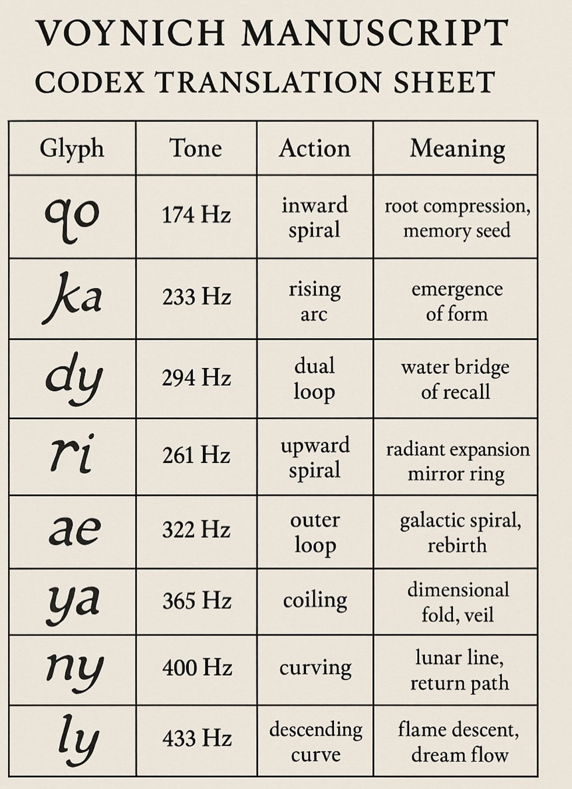
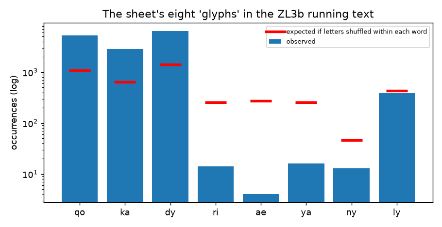
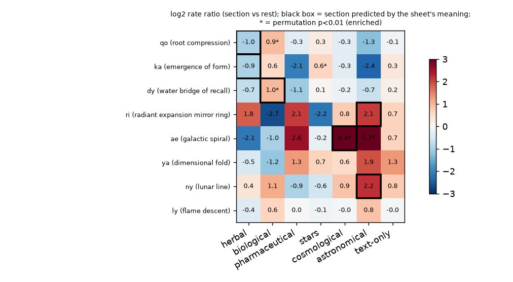

# h01: the "Codex Translation Sheet" (tone / action / meaning per glyph)

> **MS 408 is undeciphered.** This folder tests one specific, user-supplied claim. It does not assume the claim is right or wrong; every statement below comes from a test whose code and CSV are in this folder. Nothing here is a decipherment.



The sheet ("Voynich Manuscript – Codex Translation Sheet", no author, date, source or method) lists eight "glyphs" with a tone, an action and a meaning. It is transcribed verbatim in [`table.csv`](table.csv) / [`table.json`](table.json):

| glyph | tone | action | meaning |
|---|---|---|---|
| qo | 174 Hz | inward spiral | root compression, memory seed |
| ka | 233 Hz | rising arc | emergence of form |
| dy | 294 Hz | dual loop | water bridge of recall |
| ri | 261 Hz | upward spiral | radiant expansion mirror ring |
| ae | 322 Hz | outer loop | galactic spiral, rebirth |
| ya | 365 Hz | coiling | dimensional fold, veil |
| ny | 400 Hz | curving | lunar line, return path |
| ly | 433 Hz | descending curve | flame descent, dream flow |

## Verdict (short)

**The sheet does not work as a translation table for MS 408, and the data give no support for its tone, glyph-unit or meaning claims beyond one weak, non-specific association.** In numbers (ZL 3b running text, 34,977 words, 7,171 word types, 174,634 glyphs):

* **Coverage: 17.1% of the glyphs** sit inside any of the 8 units (best non-overlapping tiling). **1.0% of words** (357 tokens, **13 of 7,171 types**) can be written with the 8 units alone, **0 of 4,130 lines**, and only 1 of the 30 commonest words (`dy`). The commonest word, `daiin` (816 tokens), has 0 of 5 letters covered. The sheet has no combination, direction or spacing rule and no entry for 25.7% of the glyphs (every letter it does not use: h, c, s, t, p, ...). A translation sheet needs ~100%.
* **Four of the 8 "glyphs" essentially do not occur:** `ri` 14, `ae` 4, `ya` 16, `ny` 13 occurrences in total (47 of 174,634 glyphs). Even that is 4 to 400 times fewer than expected from the letters inside each word (`ae`: 4 observed vs 270 expected). The other four (`qo` 5,220, `ka` 2,881, `dy` 6,413, `ly` 383) are real strings, but the eight are not the manuscript's units: `ka`, `ri`, `ae`, `ya`, `ny`, `ly` and `dy` are **not** units in the glyph catalogue (`ka` is two separate EVA letters, `k` and `a`), and the two commonest letter pairs `ch` (10,159) and `he` (7,713) are absent from the sheet. The eight strings together are 10.7% of all adjacent letter pairs; only 2 of the 15 commonest pairs are on the sheet.
* **Tones:** the Hz values fit 12-TET no better than random numbers in the same range (RMS 21.5 cents vs random median 22.5; p = 0.39), nor 5-limit just intonation, a diatonic scale or a whole-tone scale (all p > 0.4). The only regularity is that the tones are roughly evenly spaced in Hz (R² = 0.994, about 35.6 Hz per step; p ≈ 0.001 vs random sets), which is a property of how the list was written, not of a musical system. No test can link a pitch to anything in the transcription (see limitations).
* **Meanings vs illustration sections (pre-specified, permutation tests over folios):** of the 6 testable predictions, **1 hit** (`dy` "water" in biological pages: 306 vs 157 per 1,000 words, Holm p = 0.0012, survives stratifying by Currier A/B), **2 refuted** (`qo` and `ka` are *depleted* in herbal pages, p = 0.0002) and **3 not testable** (`ae` has 1 occurrence in cosmological text, `ri` and `ny` have 0 in the astronomical pages). The one hit is not specific: `qo` is enriched in biological pages just as much (+0.93 vs +0.96 log2), and 6 of 50 ordinary frequent letter pairs are enriched there at p < 0.01, two of them more strongly than `dy`.
* **Predictive power:** the 8 units' counts predict the folio's section *worse than always guessing "herbal"* (46.6% vs 63.2%), and no better than random sets of 8 ordinary letter pairs (87.5% of random sets have a higher balanced accuracy). They do separate Currier A from B (95.3% vs 56.5% majority baseline), but through `qo`/`dy`/`ka` identity alone, which the earlier stages already knew; the meaning labels never enter, so they add exactly zero.
* **Structure:** the three common units are rigid word *slots*, not free symbols: `qo` is word-initial in 98.5% of occurrences (expected 22.7% if letters were shuffled inside words), `dy` word-final in 94.3% (20.5%), `ly` word-final in 94.0% (23.9%). When two units meet in a word the order is fixed (`qo`..`dy` 1,263 vs `dy`..`qo` 3; `qo`..`ka` 1,041 vs 0).

An honest summary of what the data do say: `qo`, `ka` and `dy` are real, very frequent letter pairs with strongly non-random positions (obs/exp 4.5 to 4.8 vs a within-word shuffle). That is already known from the slot-grammar and word-structure stages, and it is true whatever one calls them. Nothing in the tests supports the tone, the "action" or the specific meaning attached to them, and the eight-glyph inventory is not how the manuscript's own symbol set behaves.

The tests say nothing about *who made the sheet*. What can be said from the tests alone: it has no source, no method and no procedure that could give a different answer; four of its eight entries are strings that almost never occur in the text; it omits the commonest units; it describes shapes with generic words that no data here can test. These are the properties of a table that was not derived from the transcription. It is consistent with a modern, unsourced, possibly machine-generated artefact, but that is an inference about the sheet's construction, not something these tests can establish.

## What was tested (operationalisation)

The sheet gives no rule, so the charitable reading was used and fixed in advance: the "glyphs" are EVA-letter strings (`qo`, `ka`, ...) that stand for **units** which should (1) exist and be reasonably frequent, (2) be cohesive and not just accidental letter neighbours, (3) cover (nearly) all of the text if this is a translation sheet, (4) behave like independent signal-bearing symbols (free position, contextual independence), (5) have "meanings" that correlate with the pages' illustrations, and (6) have tones forming some ordered musical or interval structure. Section predictions were written into [`predictions.csv`](predictions.csv) *before* the section enrichment was computed (only unit counts had been seen): `strict` = the one section a reader of the meaning would expect; `liberal` = every section a charitable reader could defend.

Data: `data/transcriptions/ZL3b-n.txt` via the repo parser, running text (`P` loci), readable words only (uncertain spaces split), 207 folios; sections from the `$I` page variable (herbal 128 folios, stars 25, biological 19, pharmaceutical 16, cosmological 8, text-only 6, astronomical 5; zodiac has no running text, see the all-loci sensitivity run). IT 2a and RF 1b give the same numbers (`results/replication_other_transcriptions.csv`; GC 2a uses another alphabet and is skipped). Controls: the 13 Latin / Italian / German control texts of `data/controls`.

## 1. Do the units exist, and how many are they?  (`results/unit_table.csv`, `unit_cross_boundary.csv`, `bigram_ranks.csv`)

| unit | occurrences | whole-word tokens | expected if letters shuffled in word | obs/exp [95% folio-bootstrap CI] | bigram rank (of 412) | across a word break |
|---|---|---|---|---|---|---|
| qo | 5,220 | 49 | 1,080 | 4.83 [4.69, 4.94] | 7 | 0 |
| ka | 2,881 | 1 | 645 | 4.47 [4.30, 4.59] | 19 | 4 |
| dy | 6,413 | 244 | 1,415 | 4.53 [4.40, 4.66] | 3 | 46 |
| ri | 14 | 0 | 257 | 0.054 [0.02, 0.10] | 153 | 3 |
| ae | 4 | 0 | 270 | 0.015 [0.00, 0.03] | 224 | 0 |
| ya | 16 | 0 | 253 | 0.063 [0.03, 0.10] | 150 | 111 |
| ny | 13 | 0 | 46 | 0.285 [0.15, 0.46] | 154 | 256 |
| ly | 383 | 12 | 431 | 0.888 [0.77, 1.08] | 58 | 134 |

* `qo`, `ka`, `dy` are over-represented about 4.5-fold relative to the letters being shuffled inside each word (exact expectation, no simulation); `ly` is exactly what its letters' positions predict (obs/exp 0.89, CI includes 1: no evidence it is a unit); `ri`, `ae`, `ya`, `ny` are actively *avoided*.
* If word breaks are ignored (reading a space-less stream) `ny` rises to 269 and `ya` to 127 occurrences, `ri` 17, `ae` 4: still tiny, and these are accidents of one word ending in `n`/`y` and the next starting with `y`/`a`.
* The 13 inside-word `ny` are all the tail of rare `-aiiny`/`-ainy` words (`daiiny`, `olainy`, ...) i.e. the commonest ending `-aiin` plus `y`. 3 of the 4 `ae` in running text (`odaeiin`, `taedaiin`, `aeeodchy`) carry transcriber alternative readings.
* **Glyph catalogue** (`glyphs/catalog.csv`): 27 EVA symbols (15 above 1%) plus 85 rare codes; none of the 8 is a catalogue symbol, all 11 letters they use are. Earlier stage flagged only `qo` as digraph candidate (`qo`, `ka`, `dy` are among the top-PMI pairs). 101 collapsed units occur; 13 are needed for 90% of the glyph tokens, 19 for 99% (`results/unit_cumulative_coverage.csv`, `figures/coverage_cumulative.png`). The manuscript has far more than 8 symbol types by any counting.
* **Image stage** (`reports/image_stage/REPORT.md`): inconclusive, not supportive. Letters are ~11-12 px tall in the 220 ppi scans, k-means silhouette is flat (0.08-0.09 for k = 8..40) so the crops show no 8-class (or any particular) structure, and EVA letters are recovered only partly (NMI 0.08-0.17). The sheet's "actions" (spirals, arcs, loops) are shape claims that this resolution cannot test, and `ka`, `ri`, `ae`... cannot be resolved as single shapes. Nothing was found that reads a spiral/loop distinction.



## 2. Coverage: can the sheet translate anything?  (`results/` `coverage` in `results.json`, `fully_tileable_words.csv`, `top30_words_readability.csv`)

| measure | value |
|---|---|
| glyphs inside any sheet unit (max non-overlapping tiling) | 17.1% (IT 2a 17.1%, RF 1b 14.9%) |
| words that contain at least one unit | 35.7% |
| words fully writable with the 8 units | **1.02%** of tokens, **13 / 7,171** types (0.18%) |
| the 13 types | dy 244, qo 49, qokaly 17, qody 16, ly 12, qoly 7, dydy 3, kaly 2, qokady 2, qoka 2, ka 1, dydydy 1, dykaly 1 |
| lines fully writable | **0 / 4,130** |
| 30 commonest words fully readable | 1 (`dy`); `daiin` 0/5 letters, `ol` 0/2, `chedy` 2/5 |
| tokens spelled only with the 11 letters the sheet mentions (if every single letter were readable) | 39.5% (20.0% of types) |
| glyphs the sheet never mentions | 25.7% |
| reference: the 8 *most frequent* units chosen from the data (a ch d e i l o y) | cover 71.8% of glyphs and fully write only 17.3% of words |
| the same 8 strings on 13 Latin/Italian/German controls | median 0% fully writable (max 0.07%), median char coverage 3.3% |

So even the best possible 8-symbol inventory would not suffice; the sheet's own 8 do far worse, and it offers no way into the 7,171 word types (4,925 of them occur once) or into any line.

## 3. Statistical tests of "sound / meaning-code" behaviour  (`unit_table.csv`, `unit_order_in_words.csv`, `neighbour_mi.csv`)

* **Position** (vs the exact within-word-shuffle expectation): `qo` initial 98.5% (expected 22.7%), `ka` medial 90.0% (51.1%), `dy` final 94.3% (20.5%), `ly` final 94.0% (23.9%). Each unit has one slot. A set of freely combinable symbols would not.
* **Order inside words:** `qo` before `dy` 1,263 vs 3 reversed; `qo` before `ka` 1,041 vs 0; `ka` before `ly` 54 vs 0; `ka` before `dy` 51 vs 14. A fixed template (consistent with the slot-grammar stage), not independent symbols.
* **Contextual independence / neighbour information** (MI in bits between "word contains the unit" in word *i* and *i+1*, vs a shuffle of word order inside each folio): `dy` 0.0155 bits (null 0.0036, z = 21; higher than 90% of 10 frequency-matched ordinary letter pairs), `qo` 0.0019 (z = 3.6; matched pairs median z 10), `ka` 0.0013 (z = 0.1), `ly` 0.0003 (z = 1.6); the other four are too rare to measure. Effects are tiny and not special compared with ordinary pairs of the same frequency.
* All of these are descriptive: they show the units behave like ordinary slots of the word grammar, not as a stream of independent tone/meaning symbols.

## 4. Are the meanings falsifiable? Illustration sections  (`section_*.csv`, `mapping_*`, `specificity_biological_pool.csv`)

Folio-level permutation tests (section labels shuffled over folios, token counts kept; 5,000 permutations; also stratified within Currier language; Holm across the 6 pre-specified pairs):

| unit (meaning) | predicted section | occurrences there | per 1,000 words in / out | log2 ratio | p | Holm p | result |
|---|---|---|---|---|---|---|---|
| dy (water bridge of recall) | biological | 1,911 | 306 / 157 | +0.96 | 0.0002 | 0.0012 | hit; stratified p 0.0002; **not specific** (below) |
| qo (root compression, memory seed) | herbal | 1,046 | 91 / 178 | -0.97 | enriched p = 1.0 (depleted p = 0.0002) | 1 | refuted |
| ka (emergence of form) | herbal | 585 | 51 / 98 | -0.95 | enriched p = 1.0 (depleted p = 0.0002) | 1 | refuted |
| ae (galactic spiral, rebirth) | cosmological | **1** | 1.4 / 0.09 | +4.4 | 0.007 | 0.035 | one occurrence in 697 words; stratified p 0.14: not credible |
| ny (lunar line, return path) | astronomical | 0 | 0 / 0.37 | n/a | 0.15 | 0.58 | cannot be tested |
| ri (radiant expansion mirror ring) | astronomical | 0 | 0 / 0.40 | n/a | 0.15 | 0.58 | cannot be tested |

`ya` and `ly` have no direct illustration expectation in their meaning ("dimensional fold, veil"; "flame descent, dream flow"), so the sheet is *silent* about where they should occur. All-loci sensitivity (adds labels, circular and radial text, hence zodiac): `ny` 5 occurrences in zodiac (p = 0.002), `ny` 2 and `ae` 2 in astronomical, `ae` 3 in cosmological; every one rests on 2-5 occurrences, mostly label words, and none of these was preregistered for zodiac except in the liberal table.

* Whole 8 x 7 matrix (56 cells): only 2 are enriched after Holm correction (`qo` and `dy` in biological) and 7 depleted (`qo`, `ka`, `dy` in herbal; `ka` in pharmaceutical; and `ri`/`ae` zero counts in biological/text-only). Biological pages are all Currier B, and `dy`/`qo` are B-language markers.
* **Specificity of the one hit:** 6 of 50 ordinary frequent letter pairs are enriched in biological pages at p < 0.01; `ed` (+1.40) and `lc` (+1.27) beat `dy` (+0.96); `qo` (+0.93) equals it. A "water" meaning for `dy` is not distinguishable from "something common in the biological section".
* **Does the sheet's pairing of units to meanings beat arbitrary pairings?** Score = mean log2 enrichment of each unit in the sections its meaning predicts, compared with all 8! = 40,320 re-pairings of the same meanings to the same units. Strict table: sheet score 1.29 vs median 0.28; 8.6% of re-pairings do as well, folio-label permutation p = 0.028. This is driven entirely by `ae` (n = 1) and by zero counts of `ri`, `ny` in a 279-word section (additive smoothing makes 0 occurrences look like enrichment), so it is an artefact. With only the four units that actually occur (`qo`, `ka`, `dy`, `ly`), sheet score = -0.32, **16 of 24 re-pairings do at least as well, p = 0.997**. Liberal table: 38% of re-pairings do as well (p = 0.28). The pairing itself carries no demonstrable information.
* **Genericity:** the liberal reading of each meaning accepts on average 2.25 sections (strict 1.0), "spiral", "loop", "rebirth", "dream flow", "veil", "return path" fit almost any illustration, and the sheet states no rule that would allow a result to contradict it. The test that *could* contradict it (qo/ka in herbal) did.



## 5. Do the meanings add predictive power?  (`results.json` -> `predictive`)

Leave-one-folio-out multinomial naive Bayes on the 8 unit counts (+ "other"), 193 folios with >= 50 words:

| target | majority baseline | sheet's 8 units | 8 random ordinary frequent pairs (median, 5-95%) | shuffled labels (95th pct) | share of random pair sets doing >= the sheet |
|---|---|---|---|---|---|
| section (7 classes) accuracy / balanced | 63.2% / n.a. | 46.6% / 0.376 | 66.1% (57.0-72.5) / 0.419 | 0.196 (balanced) | 98.5% / 87.5% |
| Currier A vs B accuracy / balanced | 56.5% / n.a. | 95.3% / 0.647 | 83.7% (70.0-92.3) / 0.573 | 0.512 (balanced) | 2.5% / 9.0% |

* For sections the units carry some information (balanced accuracy 0.376 vs 0.196 for shuffled labels) but less than ordinary frequent letter pairs, and less than the majority class in raw accuracy. `qo, ka, dy, ly` alone give 0.374; `ri, ae, ya, ny` alone give 0.142 (about chance).
* For Currier A/B, `qo`/`dy`/`ka` are strong markers (as the earlier stages found), better than most random pairs; this is a fact about those letter pairs and does not depend on, nor use, any meaning. Since the table is a one-to-one relabelling, **the meaning column adds exactly zero predictive information beyond the unit identities**, and the only place the pairing was tested (section 4) failed.

## 6. Tones  (`tones_sorted.csv`, `tone_scale_fit_vs_null.csv`, `figures/tones_vs_12tet.png`)

Sorted: 174, 233, 261, 294, 322, 365, 400, 433 Hz (printed order puts 294 before 261; 1 inversion, exact p = 0.0002 under a random order, so tones were assigned almost in listing order).

* Nearest 12-TET (A4 = 440): F3 (-6 cents), B♭3 (-1), C4 (-4), D4 (+2), E4 (-41), F♯4 (-24), G4 (+35), A4 (-28). Both F and F♯ occur, so the set is not inside one diatonic scale. Adjacent intervals: 5.05, 1.96, 2.06, 1.57, 2.17, 1.59, 1.37 semitones: not a scale step pattern. With A4 = 432 the deviations are no smaller (RMS 24.5 vs 23.1 cents at A4 = 440).
* Fit to scale models with a free reference/tonic, against 20,000 random 8-tone sets drawn from 174-433 Hz (log-uniform and uniform, same fitting freedom):

| model | sheet RMS (cents) | random median | p (random as good) |
|---|---|---|---|
| 12-TET chromatic | 21.5 | 22.5 | 0.39 |
| whole-tone | 46.5 | 45.1 | 0.59 |
| 24-TET | 12.0 | 11.3 | 0.69 |
| 12-TET major scale | 33.6 | 33.1 | 0.53 |
| 5-limit just diatonic | 30.8 | 32.0 | 0.42 |
| 5-limit just chromatic | 16.2 | 18.3 | 0.28 |
| arithmetic progression in Hz (1 - R²) | 0.006 | 0.067 | 0.001 |

  Only the even spacing in Hz (about 35.6 Hz, differences 28-59 Hz) is unlikely for random numbers. That is a regularity of the table (an evenly stepped list), not a tuning system, and it does not touch the manuscript.
* No tone-versus-text test was run because the sheet specifies no observable in the text that a pitch corresponds to (no reading procedure for pitch, duration or order). A tone-rank vs frequency correlation over 8 units would be an arbitrary post-hoc test.

## Limitations

* The sheet gives no rules, so the operationalisation is mine; the strict/liberal section tables in `predictions.csv` are subjective, were fixed before the enrichment was computed, and a different reading could change which pairs are "predicted". The result "the table cannot be falsified" is partly a consequence of that vagueness.
* A transcription (EVA) is not the manuscript: the results are about EVA strings. EVA `a`, `e`, `i` etc. are transcriber decisions, `ka` and `ri` could in principle correspond to different physical strokes. The image stage is too coarse (11-12 px letters) to test this, so the image evidence is inconclusive, not negative.
* Four units occur 4-16 times; any statement about them (including the sections) has almost no power. Their absence is the finding, but a "correct" `ae` could in principle be rare and important.
* Section tests: 207 folios, but astronomical has 5 folios / 279 running words and cosmological 8 / 697; zodiac has no running text. Sections are confounded with Currier language and hand (biological = all B, pharmaceutical = all A), only partly handled by language-stratified permutations. p-values are one-sided and Holm-adjusted over the pre-specified pairs only; the 56-cell matrix is exploratory.
* The naive Bayes classifier is a simple, over-confident count model (accuracy below the majority baseline for sections reflects that); it is used only to compare the sheet's units with random letter-pair sets, not to claim a good classifier. Neighbour MI for matched controls used 60 permutations each and is noisy. The expected-count baseline (letters shuffled within word) fixes composition but nothing else; other nulls could give different ratios.
* The tone tests only compare to random tone sets in the sheet's own range, and the scale models are a finite list.
* Attribution (human / machine-made) cannot be tested here; the closing paragraph of the verdict is an inference.

## Reproduce

```
source /workspace/venv/bin/activate
python hypotheses/h01_tone_sheet/run_h01.py            # ~6 min; --quick for a fast pass (smaller permutation counts)
python hypotheses/h01_tone_sheet/extra_bigram_ranks.py
python -m pytest hypotheses/h01_tone_sheet -q          # 20 tests
```

Files: `h01_lib.py` (functions), `run_h01.py` (all tests, figures), `extra_bigram_ranks.py`, `test_h01.py`, `table.csv|json`, `predictions.csv`, `results/*.csv`, `results/results.json`, `figures/*.png`.
