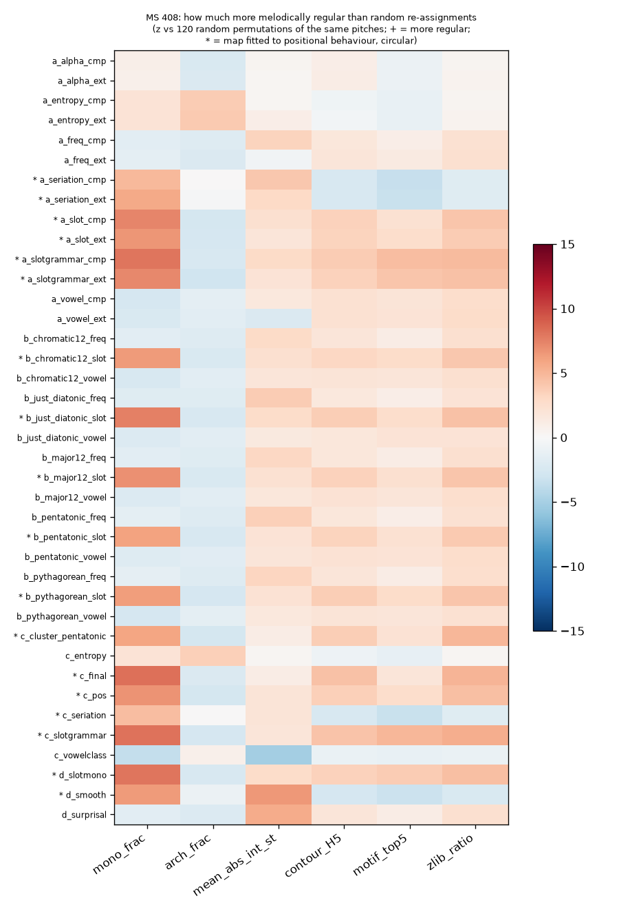
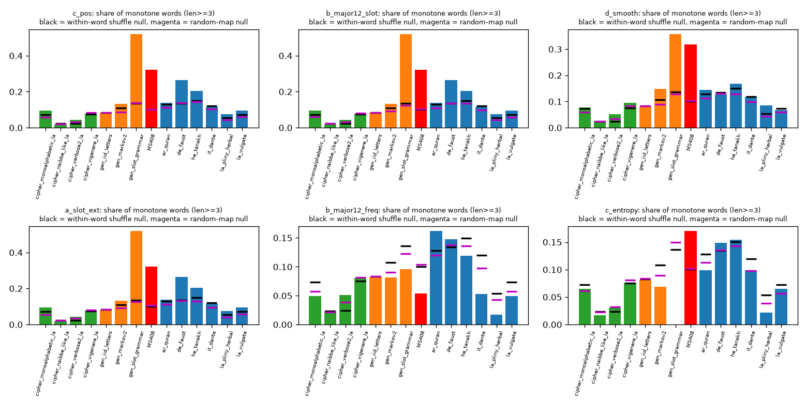
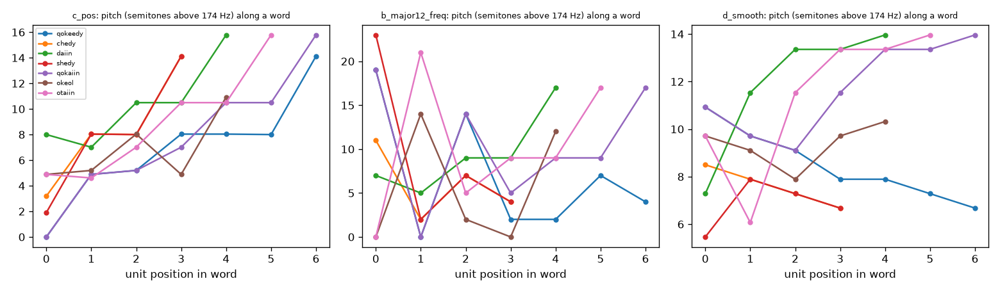

# h02: a full tone map for every manuscript unit (hypothesis generation, then tests)

> **MS 408 is undeciphered. A frequency (Hz) assignment is a hypothesis-generation device with no evidential link to the manuscript unless it beats the null.** The maps below are invented schemes. They were tested against (i) random re-assignments of the same pitches to the units, (ii) the same units shuffled inside each word, and (iii) 13 control texts mapped with the same scheme. **Any pattern found by a map that was fitted to the data (position, slot, seriation, ...) is partly circular:** a map that is monotone in a unit's word position makes words monotone by construction. All fitted maps are therefore cross-fitted (fitted on one half of the folios, evaluated on the other), which removes over-fitting but not that conceptual circularity. This extends [h01](../h01_tone_sheet/README.md), which found that the sheet's 8 entries are not a translation table.

## Verdict (short)

1. **Nothing in the sheet's own 8 values says how to extend it.** Of 7 candidate orderings of the manuscript's units, none is significantly supported by the 8 Hz values (best: expected slot of the learned slot grammar, Spearman rho = 0.62, two-sided p = 0.12, Holm p = 0.71; mean relative word position rho = 0.60, p = 0.13; frequency rank rho = 0.50, p = 0.22; alphabetical rho = -0.02). The only ordering that fits (rho = 0.976, p = 0.001, Holm p = 0.005; linear fit R² = 0.95, 34.8 Hz per row, leave-one-out RMSE 23 Hz vs 77-108 Hz for the others) is **the printed row order of the table itself**, which is not a property of the manuscript. So every extension is a free choice.
2. **No map yields structure that is both beyond the nulls and not a consequence of how the map was built.** Under the 18 maps fitted to positional behaviour, MS 408 words are far more melodically regular than the nulls (e.g. `c_pos`: 32.3% of words (>= 3 units) are monotone vs 10.1% after shuffling letters inside words and 10.1% under random pitch assignment; mean absolute interval 3.7 vs 5.0 semitones; Parsons-contour entropy of 5-unit words 3.45 vs 4.69 bits; 54 of the 108 (map, statistic) pairs beat both nulls at p <= 0.01). That is the rigid word grammar that the earlier stages already measured, re-expressed as pitch, and it is circular. Under the 21 maps that do not use position (frequency, alphabet, vowel-likeness, scales by frequency, surprisal, entropy, vowel class) only 9 of 126 pairs beat both nulls, mostly the generic compression statistic that natural text shows equally (see 3), i.e. about what chance gives (126 pairs at 1%).
3. **Against controls:** under the same positional maps MS 408 exceeds every natural-language control on the share of monotone words and on smoothness (effect over the within-word-shuffle null: monotone share +0.22 vs a natural-text maximum of +0.13 (German); `c_slotgrammar` +0.25 vs +0.13), but **not** the slot-grammar generator (+0.38), which has rigid slots by design. It does not exceed natural texts on compressibility of the contour stream (zlib ratio 0.205 vs 0.243 shuffled, a 16% gain; natural texts gain 10-16%: Latin 0.215 vs 0.252, Italian 0.213 vs 0.253, German 0.222 vs 0.246), on contour entropy, motif concentration or repetition; under `c_pos` it has *fewer* arch-shaped words than any control (-0.156 vs -0.105..+0.005 relative to shuffling). Verbose-cipher, Vigenère and i.i.d. controls show none of the effect. This is the same "unusually rigid positional structure" as before; it is not new evidence for any pitch or meaning.
4. **Sections and Currier A/B:** per-folio mean pitch and mean interval differ between illustration sections and between A and B for most maps (T1, mean pitch: section p <= 0.01 for 28 of 39 maps, 21 of 39 even when sections are permuted only within Currier language; A vs B p <= 0.01 for 35 of 39). For 16 maps the section effect exceeds the 95th percentile of random maps, 18 for A/B. This restates that unit *frequencies* differ by section and hand (an arbitrary random map gives eta² = 0.04 median, the maps 0.13); it does not make any pitch meaningful, and no map was predicted to match a section.
5. **Pick for further hypothesis generation (not a result):** if one has to choose a single extension, `a_slotgrammar_ext` is the most defensible under a stated objective: it keeps the sheet's 8 printed Hz, extends them by a linear fit on the best-supported (still non-significant) ordering, and makes words melodic contours (monotone in 35.5% of words vs 10.1% by chance). It is circular for exactly that statistic. Its table is in `results/map_table_wide_T2.csv` (column `a_slotgrammar_ext`). `d_slotmono` (equally spaced pitches in slot order) gives the strongest contour regularity (5 of 6 statistics beat both nulls) and `d_smooth` the smoothest melody (mean interval 1.68 semitones).

The pitch layer adds nothing testable beyond what the letter-position statistics already say: for any injective map, repetition and motif statistics are identical to letter n-gram statistics (`repeat4` is 0.944 for every injective map, 0.759 after shuffling letters in words).

## 1. The maps  (`results/maps_description.csv`, `results/map_table_wide_T1.csv`, `map_table_wide_T2.csv`, `map_table_long.csv`)

**Units.** `T1` = the 27 collapsed EVA units with >= 20 occurrences in ZL 3b running text (ch, sh, cth, ckh, cph, cfh and single letters); `T2` = T1 plus the sheet's 8 digraphs (`qo ka dy ri ae ya ny ly`) as extra units found by greedy longest match (35 units; `ri`, `ae`, `ya`, `ny` occur 14, 4, 12 and 13 times and are kept only in T2). The other 74 collapsed unit types seen in the running text have count < 20 (rare EVA letters such as `b j u` and the `@nnn;` rare codes of `glyphs/catalog.csv`) and get no map: their statistics are too thin; `results/rare_units_fallback.csv` lists a position-based fallback Hz for them (`c_pos` formula) and nothing else. Tonic of every scale map is 174 Hz (the sheet's lowest tone), range-matched continuous maps span the sheet's 174-433 Hz (1,577 cents, log-spaced).

Per-unit statistics (`results/unit_statistics_T2.csv`) come from the training half only: count, frequency rank, mean relative position in the word (0 = initial, 1 = final), share initial/final, H(next unit | unit), surprisal, Fiedler (seriation) coordinate of the within-word adjacency graph, Sukhotin vowel-like class, expected slot of a 12-slot grammar re-learned by EM (`msdecipher.slot_grammar`), and a k = 5 k-means cluster of positional behaviour. Orderings use these (`freq`, `slot`, `alpha`, `vowel`, `entropy`, `seriation`, `slotgrammar`).

| group | maps (39 in total) | idea |
|---|---|---|
| **a** extend the sheet | `a_<order>_ext` and `a_<order>_cmp` for 7 orderings (14 maps) | `ext`: Hz = a + b * rank, with (a, b) regressed on the sheet's 8 values where those units exist (T2; the 8 keep their printed Hz), else 174 Hz + 35.57 Hz per rank (the sheet's own near-even step). `cmp`: ranks spread evenly over 174-433 Hz |
| **b** musical scales | `b_<scale>_<order>`: 12-TET chromatic, 12-TET major, 5-limit just diatonic, Pythagorean, pentatonic; orderings `freq`, `slot`, `vowel` (15 maps) | one scale degree per unit going up from 174 Hz (units beyond one octave continue upward; with 27-35 units the highest notes are 3-5 octaves up) |
| **c** data-driven | `c_pos`, `c_final`, `c_entropy`, `c_seriation`, `c_slotgrammar` (log-Hz linear in the statistic), `c_cluster_pentatonic` (5 clusters -> 5 pitches, non-injective), `c_vowelclass` (2 pitches) | pitch from behaviour |
| **d** objective | `d_surprisal` (pitch spread proportional to information content), `d_smooth` (equally spaced pitches assigned to minimise sum W_ij abs(p_i - p_j) over within-word neighbours: smoothest melody), `d_slotmono` (equally spaced in slot order: words become contours) | stated objective |

Plus the null: `rand` = random permutation of any map's pitch values over the units (120 draws per map and fold for MS 408, 40 for controls). A short sample of the T2 table (full table: CSV):

| unit | count | sheet Hz | a_slotgrammar_ext | a_slot_cmp | b_major12_freq | c_pos | c_cluster_pentatonic | d_smooth | d_surprisal |
|---|---|---|---|---|---|---|---|---|---|
| e | 18,049 | | 298 | 314 | 174 | 284 | 219 | 234 | 174 |
| o | 17,106 | | 274 | 260 | 195 | 237 | 195 | 267 | 175 |
| ch | 10,121 | | 232 | 204 | 232 | 210 | 195 | 240 | 185 |
| y | 9,287 | | 340 | 359 | 293 | 367 | 293 | 228 | 187 |
| qo | 5,215 | 174 | 174 | 174 | 585 | 174 | 174 | 253 | 199 |
| dy | 6,406 | 294 | 294 | 400 | 391 | 427 | 293 | 222 | 195 |
| sh | 4,250 | | 223 | 189 | 696 | 195 | 174 | 216 | 204 |
| ka | 2,875 | 233 | 233 | 267 | 781 | 243 | 219 | 298 | 212 |
| ly | 382 | 433 | 433 | 410 | 1,392 | 428 | 293 | 359 | 264 |
| ae | 4 | 322 | 322 | 210 | 5,256 | 213 | 219 | 433 | 433 |

### Which ordering do the sheet's 8 values support?  (`results/ordering_support_of_the_8_values.csv`, `figures/ordering_support.png`)

| ordering | Spearman rho | p (two-sided, exact permutation) | Holm p | R² of linear rank fit | slope (Hz/rank) | leave-one-out RMSE (Hz) |
|---|---|---|---|---|---|---|
| frequency rank | 0.50 | 0.215 | 0.86 | 0.24 | 17.6 | 91 |
| mean position in word | 0.60 | 0.129 | 0.71 | 0.39 | 22.2 | 86 |
| alphabetical | -0.02 | 0.976 | 0.98 | 0.00 | -0.9 | 101 |
| vowel-like first | 0.41 | 0.327 | 0.98 | 0.17 | 14.9 | 108 |
| H(next unit) | -0.67 | 0.083 | 0.58 | 0.49 | -24.9 | 78 |
| seriation | 0.41 | 0.326 | 0.98 | 0.19 | 15.6 | 92 |
| expected slot | 0.62 | 0.118 | 0.71 | 0.42 | 23.2 | 81 |
| **printed row order** | **0.976** | **0.001** | **0.005** | 0.95 | 34.8 | 23 |

With 8 points a rho of 0.6 is not distinguishable from chance. The slot-type orderings point the same way (initial units low, final units high) but so does nothing strongly; extrapolating the 8 values to ~30 units rests on a fit with R² <= 0.42 and a leave-one-out error of about 80 Hz, larger than half the sheet's whole span.

## 2. Tests of the pitch sequences  (`results/map_stats.csv`, `ms_map_summary.csv`, `ms_vs_controls_scores.csv`)

Every word becomes a pitch sequence under a map; maps are fitted on one folio parity (alternate folios; for controls alternate 500-word blocks) and evaluated on the other, both directions pooled. Statistics per word (words of >= 3 units unless stated): share of **monotone** words (ties allowed), net ascending share, **arch** and **valley** shares, mean absolute interval (semitones), interval entropy, **contour entropy** (Parsons U/D/R code, 4- and 5-unit words), **motif concentration** (share of the 5 commonest 3-step motifs), **repetition** of 4-unit pitch windows, and **compression** (zlib ratio of the Parsons stream). Each is compared with (a) within-word letter shuffles (120 for MS, 40 for controls) and (b) random re-assignments of the same pitches (same numbers). `p` = fraction of null draws at least as regular (min p = 0.008 for MS 408, 0.024 for controls); z-scores are in the CSV but huge because the shuffle sd is tiny, so effects are reported as obs - null.

MS 408, T1 (`ms_map_summary.csv`; `beats` = number of the 6 regularity statistics mono_frac, arch_frac, mean_abs_int, contour_H5, motif_top5, zlib_ratio with p <= 0.01 against both nulls; `> natural` = number where MS 408's effect over its shuffle null exceeds the maximum of the 6 natural controls under the same map):

| map | uses position | distinct pitches | monotone share | shuffled null | random-map null | mean abs interval (st) | contour H5 (bits) | zlib ratio | beats both nulls | > natural max |
|---|---|---|---|---|---|---|---|---|---|---|
| `a_slotgrammar_ext` | yes | 27 | 0.355 | 0.101 | 0.104 | 7.03 | 3.40 | 0.203 | 4/6 | 3/6 |
| `a_slot_ext` | yes | 27 | 0.323 | 0.101 | 0.108 | 7.16 | 3.45 | 0.205 | 3/6 | 2/6 |
| `a_freq_ext` | no | 27 | 0.054 | 0.101 | 0.104 | 10.20 | 3.67 | 0.211 | 0/6 | 0/6 |
| `a_alpha_ext` | no | 27 | 0.127 | 0.101 | 0.103 | 9.27 | 3.79 | 0.218 | 0/6 | 2/6 |
| `a_vowel_ext` | no | 27 | 0.031 | 0.101 | 0.105 | 12.15 | 3.63 | 0.210 | 1/6 | 0/6 |
| `a_entropy_ext` | no | 27 | 0.170 | 0.101 | 0.104 | 8.36 | 3.99 | 0.217 | 1/6 | 3/6 |
| `b_major12_slot` | yes | 27 | 0.323 | 0.101 | 0.104 | 11.50 | 3.45 | 0.205 | 3/6 | 2/6 |
| `b_major12_freq` | no | 27 | 0.054 | 0.101 | 0.104 | 9.91 | 3.67 | 0.211 | 1/6 | 0/6 |
| `b_major12_vowel` | no | 27 | 0.031 | 0.101 | 0.100 | 12.42 | 3.63 | 0.210 | 0/6 | 0/6 |
| `b_pentatonic_slot` | yes | 27 | 0.323 | 0.101 | 0.112 | 16.04 | 3.45 | 0.205 | 3/6 | 2/6 |
| `b_just_diatonic_freq` | no | 27 | 0.054 | 0.101 | 0.104 | 9.90 | 3.67 | 0.211 | 0/6 | 0/6 |
| `c_pos` | yes | 27 | 0.323 | 0.101 | 0.101 | 3.71 | 3.45 | 0.205 | 3/6 | 2/6 |
| `c_final` | yes | 27 | 0.331 | 0.101 | 0.103 | 3.67 | 3.32 | 0.202 | 3/6 | 2/6 |
| `c_entropy` | no | 27 | 0.170 | 0.101 | 0.102 | 4.20 | 3.99 | 0.217 | 1/6 | 3/6 |
| `c_seriation` | yes | 27 | 0.245 | 0.101 | 0.101 | 1.64 | 4.23 | 0.225 | 1/6 | 2/6 |
| `c_cluster_pentatonic` | yes | 5 | 0.576 | 0.200 | 0.227 | 2.37 | 3.97 | 0.220 | 2/6 | 4/6 |
| `c_vowelclass` | no | 2 | 0.114 | 0.307 | 0.553 | 12.17 | 3.68 | 0.219 | 0/6 | 0/6 |
| `c_slotgrammar` | yes | 27 | 0.355 | 0.101 | 0.106 | 3.43 | 3.40 | 0.203 | 4/6 | 3/6 |
| `d_surprisal` | no | 27 | 0.054 | 0.101 | 0.099 | 1.72 | 3.67 | 0.211 | 1/6 | 0/6 |
| `d_smooth` | yes | 27 | 0.318 | 0.101 | 0.102 | 1.68 | 4.24 | 0.226 | 2/6 | 2/6 |
| `d_slotmono` | yes | 27 | 0.355 | 0.101 | 0.101 | 3.92 | 3.40 | 0.203 | 5/6 | 3/6 |

(All 39 maps, T1 and T2, in `ms_map_summary.csv`; T1 and T2 monotone shares correlate at r = 0.96, so adding the sheet's digraphs changes nothing.)

Reading:
* **Position-fitted maps** (`*` in `figures/ms_z_vs_random_map.png`): words rise from initial to final unit (net ascending 32% vs 0 after shuffling; arch shape 2.1% vs 17.7% shuffled; valley 24.1% vs 17.9%). This is by construction of the maps (high pitch = word-final units) *and* of the manuscript: 54 of 108 (map, statistic) pairs beat both nulls. Cross-fitting changes almost nothing (|cross-fit - in-sample| median 0.0002, max 0.04 in monotone share), so this is not over-fitting, it is circularity: the map encodes the very regularity that is then found.
* **Non-positional maps** (frequency, alphabet, vowel-likeness, scales by those, surprisal): words are not more monotone than the nulls (frequency-ordered scales: 5.4% vs 10.1%, i.e. *less*: frequent units are not placed in position order); 9 of 126 pairs beat both nulls, 5 of them the compression ratio (a_vowel_ext, b_major12_freq, b_pentatonic_freq, b_pentatonic_vowel, d_surprisal), which natural texts show to the same degree; 3 the arch share of the entropy maps (`c_entropy`, `a_entropy_*`: arch share higher than controls, effect +0.26 vs natural max +0.11; H(next) is itself partly positional because final units are followed by the word end), 1 contour entropy.
* **MS 408 vs controls (same map; `ms_vs_controls_scores.csv`, `figures/mono_frac_ms_vs_controls.png`).** Under `c_pos`: MS monotone share 0.323 (effect over shuffle null +0.222); natural controls 0.076-0.264 (effect -0.005 to +0.130; German highest, Latin 0.094 vs 0.073, Hebrew 0.203 vs 0.150); Latin monoalphabetic cipher = Latin (a bijection changes nothing under a data-driven map); Vigenère +0.002, verbose +0.019, Naibbe-like -0.006; i.i.d. letters 0.000; order-2 Markov +0.025; slot-grammar generator 0.519 (+0.382). Mean interval effect: MS -1.26 semitones vs natural max -0.44 (smoother) and slot-grammar generator -1.29. Compression gain, contour entropy and motif concentration: inside the natural range (`c_slotgrammar` just above it on compression: 0.041 vs 0.037); arch share: fewer arches than any control. So the one robust cross-text difference is rigid position-dependent word structure, as in the word-structure stage; no pitch map reveals anything else.
* **Compression gain:** zlib ratio of the contour stream is 16% below the shuffled null for MS 408 and 10-16% below for the natural texts (Latin 0.215 vs 0.252; Italian 0.213 vs 0.253; Hebrew 0.206 vs 0.233; German 0.222 vs 0.246); the gain comes from letter order inside words, which every language has.





## 3. Sections and Currier A/B  (`results/section_tests_flagged.csv`, `section_summary.csv`, `section_stratified.csv`, `figures/section_eta2_vs_random.png`)

Per-folio mean pitch (cents), mean interval and monotone share (held-out map values), eta² against the 7 illustration sections, and A-vs-B standardised difference; folio-label permutations (1,000), each also compared with 40 random-map draws, and a version permuting section labels only within Currier language (`section_stratified.csv`).

| T1 statistic | maps with section p <= 0.01 (of 39) | within-language p <= 0.01 | beating random-map 95th pct | A vs B p <= 0.01 | beating random 95th pct |
|---|---|---|---|---|---|
| mean pitch | 28 | 21 | 16 | 35 | 18 |
| mean interval | 37 | 27 | 26 | 34 | 18 |
| monotone share | 24 | 1 | 0 | 27 | 4 |

The result is real but uninformative: it follows unit frequencies (the maps with the largest effect, e.g. `a_freq_*`, `b_*_freq`, `a_vowel_*`, eta² about 0.25-0.30, are just frequency-weighted ranks), and monotone share, the contour statistic, carries almost no section signal once language is held fixed (1 of 39). No map was predicted to match a section; the sheet's meaning-to-section predictions were already tested and failed in h01.

## 4. Audio illustrations  (`audio/`)

Five 7-second WAV files (sine tones, 11 kHz, 150 KB each) of the first line of f1r under `c_pos`, `b_major12_slot`, `b_pentatonic_freq`, `d_smooth` and a random permutation of the `c_pos` pitches (`audio/README.md`). **Illustration only**: pitches above 1.4 kHz are folded down by octaves; hearing a contour proves nothing.

## Limitations

* The schemes are mine and there is no ground truth; "most likely" is only relative to a stated objective. Rank-based maps depend on arbitrary orderings of the units. The 8 sheet values are 8 points; ordering support has no power to separate close orderings.
* EVA units are a transcription choice (collapsed units; T2 adds greedy digraph merges). Words with units of count < 20 (about 0.4% of tokens) are dropped from the tests; the 74 rare units get only the fallback in `rare_units_fallback.csv`.
* Statistics are within-word contours (the only level where a map matters for injective maps). Cross-word melodies, rhythm, durations and polyphony were not tried. Under injective maps, repetition and motif statistics are unit n-gram statistics, so they cannot tell a map from its relabelling.
* Nulls: 120 (MS) and 40 (controls) draws, so p-values have floors of 0.008 and 0.024; 234 (map, statistic) tests per tokenisation, about 2 chance hits at 1%. Cross-fitting uses alternate-folio halves (and alternate 500-word blocks for controls); one fold assignment, one seed. Control texts: 6 natural (Latin x2, Italian, German, Hebrew, Arabic), 4 ciphers of one Latin text, 3 generators, 1 sample each (35,000 words, German 30,891); ciphers/generators are crude, one seed. The slot-grammar generator was designed with Voynichese slot descriptions in mind (see `controls_transforms.py`), so resembling MS 408 on position is expected there.
* The section tests are folio-level with sections confounded with language and hand (partly handled by within-language permutation); astronomical (5 folios) and cosmological (8) have little power.
* Nothing here supports a tonal or musical reading of the manuscript. A pitch is a relabelling of a unit; the only information the maps can reveal is the information already in unit order and frequency.

## Reproduce

```
source /workspace/venv/bin/activate
python hypotheses/h02_full_tone_map/run_h02.py           # ~13 min on 8 cores (--quick for a fast smoke run)
python hypotheses/h02_full_tone_map/section_stratified.py  # ~6 min
python hypotheses/h02_full_tone_map/make_report.py        # summaries + figures
python hypotheses/h02_full_tone_map/make_audio.py
python -m pytest hypotheses/h02_full_tone_map -q          # 14 tests
```

Files: `h02_lib.py` (units, maps, statistics, cross-fit evaluator), `run_h02.py`, `section_stratified.py`, `make_report.py`, `make_audio.py`, `test_h02.py`, `results/`, `figures/`, `audio/`.
