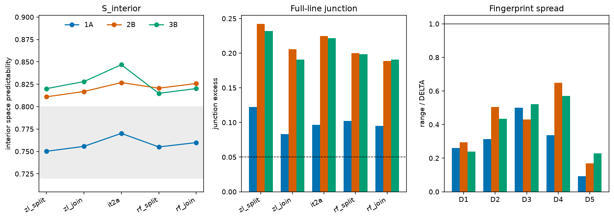

# h40: transcription sensitivity of the space, junction, and fingerprint targets

Pre-registration: [PREREG.md](PREREG.md). Five readings of hands 1A, 2B and 3B (ZL3b split, ZL3b join, IT2a, RF1b split, RF1b join). Space predictability and junction excess use the first 10,326 paragraph tokens. The fingerprint is the bifolium D1–D5 score on up to 10,500 tokens. No reading of the manuscript is proposed.

## Predictions

| prediction | result |
|---|---|
| R1 | pass |
| R2 | pass |
| R3 | pass |

R1 asks whether, for every hand and every one of D1–D5, the range across the five readings is at most `h20_lib.DELTA`. Result: pass.

R2 asks whether at least one of the nine h39 variant-A cells has space predictability outside [0.72, 0.80] and inside its hand's widened band. 4 of 9 do. 3 of 9 sit in the old band and 4 of 9 sit in the widened band. Result: pass.

R3 asks whether full-line junction excess stays above 0.05 in all 15 cells and above the stored h33 generator junctions (orig maximum 0.003420, all of those orig values ≤ 0.004). Minimum junction is 0.083146. Any cell ≤ 0.05: false. Result: pass.

## Widened bands

Old band, every hand: [0.72, 0.80]. Widened band: min and max of S_interior across the five readings.

| hand | S_interior min | S_interior max | width |
|---|---|---|---|
| 1A | 0.750157 | 0.770140 | 0.019982 |
| 2B | 0.810948 | 0.826825 | 0.015877 |
| 3B | 0.814853 | 0.846777 | 0.031925 |

## Space and junction

S is entropy removed by `h33_lib.space_predict`. Junction is `h33_lib.junction` with seed 33. The R3 junction is the full-line value (lines of at least two words). `J_interior` is the same function on line-interior words.

| hand | condition | S_full | S_interior | junction | J_interior |
|---|---|---|---|---|---|
| 1A | zl_split | 0.741277 | 0.750157 | 0.122194 | 0.120004 |
| 1A | zl_join | 0.744997 | 0.755620 | 0.083146 | 0.081429 |
| 1A | it2a | 0.758587 | 0.770140 | 0.096610 | 0.090589 |
| 1A | rf_split | 0.743608 | 0.755012 | 0.102040 | 0.100618 |
| 1A | rf_join | 0.748794 | 0.759858 | 0.094837 | 0.093199 |
| 2B | zl_split | 0.798004 | 0.810948 | 0.242325 | 0.237005 |
| 2B | zl_join | 0.801410 | 0.816859 | 0.205521 | 0.196786 |
| 2B | it2a | 0.816755 | 0.826825 | 0.224904 | 0.214305 |
| 2B | rf_split | 0.810074 | 0.820617 | 0.199794 | 0.200707 |
| 2B | rf_join | 0.814452 | 0.825795 | 0.188715 | 0.192943 |
| 3B | zl_split | 0.801870 | 0.820080 | 0.231701 | 0.233612 |
| 3B | zl_join | 0.806144 | 0.827932 | 0.190872 | 0.187566 |
| 3B | it2a | 0.827555 | 0.846777 | 0.221486 | 0.217286 |
| 3B | rf_split | 0.797639 | 0.814853 | 0.198559 | 0.207049 |
| 3B | rf_join | 0.802034 | 0.820158 | 0.190613 | 0.196749 |

Relative drop in full-line junction when uncertain spaces are joined, `(split - join) / split`:

| hand | pair | split | join | relative drop |
|---|---|---|---|---|
| 1A | zl | 0.122194 | 0.083146 | 0.319556 |
| 1A | rf | 0.102040 | 0.094837 | 0.070589 |
| 2B | zl | 0.242325 | 0.205521 | 0.151875 |
| 2B | rf | 0.199794 | 0.188715 | 0.055451 |
| 3B | zl | 0.231701 | 0.190872 | 0.176216 |
| 3B | rf | 0.198559 | 0.190613 | 0.040022 |

## Fingerprint

Bifolium folds only, cell kind `ctrl`, EVA segmentation. D3 is cross-fitted λ at W=5. Match counts use `h20_lib.match` against the three committed MS cells.

| hand | condition | D1 | D2 | D3 | D4 | D5 | match |
|---|---|---|---|---|---|---|---|
| 1A | zl_split | -0.175474 | 0.245096 | 0.041683 | 0.061696 | 1.933330 | 5/5 |
| 1A | zl_join | -0.201423 | 0.232410 | 0.036001 | 0.092924 | 1.939610 | 5/5 |
| 1A | it2a | -0.201472 | 0.236879 | 0.040889 | 0.065001 | 1.932123 | 5/5 |
| 1A | rf_split | -0.189668 | 0.213693 | 0.037427 | 0.091232 | 1.925785 | 5/5 |
| 1A | rf_join | -0.198523 | 0.214053 | 0.034171 | 0.095448 | 1.927345 | 5/5 |
| 2B | zl_split | -0.132900 | 0.222798 | 0.034580 | 0.050770 | 1.747001 | 5/5 |
| 2B | zl_join | -0.162281 | 0.210298 | 0.032335 | 0.077055 | 1.761343 | 5/5 |
| 2B | it2a | -0.156160 | 0.260691 | 0.038789 | 0.012049 | 1.756062 | 5/5 |
| 2B | rf_split | -0.145122 | 0.228068 | 0.037062 | 0.046928 | 1.772431 | 5/5 |
| 2B | rf_join | -0.150941 | 0.211414 | 0.034138 | 0.068039 | 1.771696 | 5/5 |
| 3B | zl_split | -0.166725 | 0.200221 | 0.026357 | 0.081540 | 1.815847 | 5/5 |
| 3B | zl_join | -0.190542 | 0.190051 | 0.023089 | 0.104843 | 1.826849 | 5/5 |
| 3B | it2a | -0.182383 | 0.233569 | 0.030050 | 0.047815 | 1.814555 | 5/5 |
| 3B | rf_split | -0.183939 | 0.221960 | 0.030901 | 0.063757 | 1.846777 | 5/5 |
| 3B | rf_join | -0.181354 | 0.225747 | 0.029577 | 0.066171 | 1.848788 | 5/5 |

| hand | statistic | min | max | range | DELTA | within DELTA |
|---|---|---|---|---|---|---|
| 1A | D1 | -0.201472 | -0.175474 | 0.025999 | 0.100000 | yes |
| 1A | D2 | 0.213693 | 0.245096 | 0.031403 | 0.100000 | yes |
| 1A | D3 | 0.034171 | 0.041683 | 0.007512 | 0.015000 | yes |
| 1A | D4 | 0.061696 | 0.095448 | 0.033752 | 0.100000 | yes |
| 1A | D5 | 1.925785 | 1.939610 | 0.013826 | 0.150000 | yes |
| 2B | D1 | -0.162281 | -0.132900 | 0.029381 | 0.100000 | yes |
| 2B | D2 | 0.210298 | 0.260691 | 0.050393 | 0.100000 | yes |
| 2B | D3 | 0.032335 | 0.038789 | 0.006454 | 0.015000 | yes |
| 2B | D4 | 0.012049 | 0.077055 | 0.065006 | 0.100000 | yes |
| 2B | D5 | 1.747001 | 1.772431 | 0.025430 | 0.150000 | yes |
| 3B | D1 | -0.190542 | -0.166725 | 0.023818 | 0.100000 | yes |
| 3B | D2 | 0.190051 | 0.233569 | 0.043519 | 0.100000 | yes |
| 3B | D3 | 0.023089 | 0.030901 | 0.007812 | 0.015000 | yes |
| 3B | D4 | 0.047815 | 0.104843 | 0.057028 | 0.100000 | yes |
| 3B | D5 | 1.814555 | 1.848788 | 0.034233 | 0.150000 | yes |

## h39 variant A against the bands

S is the stored variant-A space predictability (the table column S; full precision from the row that was printed to three decimals). The old band is [0.72, 0.80].

| hand | gen | S | S table | old band | widened band |
|---|---|---|---|---|---|
| 1A | C0 | 0.737711 | 0.738 | in | out |
| 1A | naibbe_it | 0.741205 | 0.741 | in | out |
| 1A | naibbe_nonsense | 0.790545 | 0.791 | in | out |
| 2B | C0 | 0.824550 | 0.825 | out | in |
| 2B | naibbe_it | 0.822249 | 0.822 | out | in |
| 2B | naibbe_nonsense | 0.836636 | 0.837 | out | out |
| 3B | C0 | 0.824223 | 0.824 | out | in |
| 3B | naibbe_it | 0.807911 | 0.808 | out | out |
| 3B | naibbe_nonsense | 0.840083 | 0.840 | out | in |

## Figure

Grey band on the left is [0.72, 0.80]. The dashed line on the junction panel is 0.05. The line on the fingerprint panel is range = DELTA.

Run: `python3 test_h40.py` (unit tests), `python3 run_h40.py`, `python3 summarise.py`.
